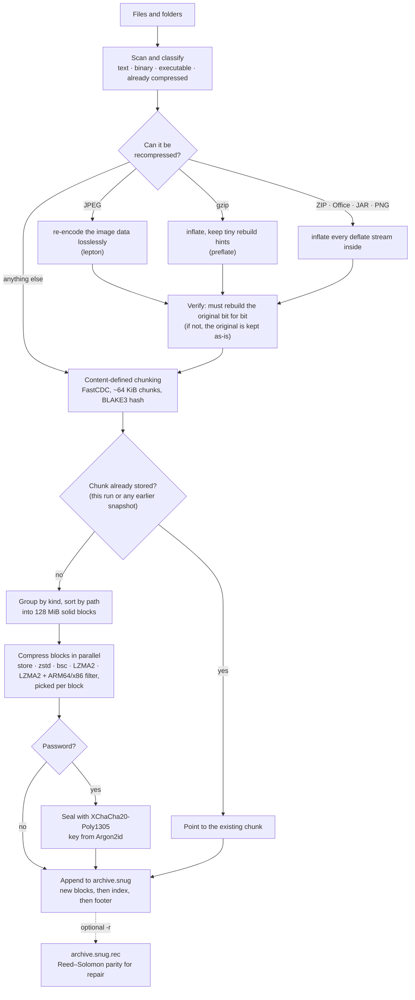

# snugly

[](https://github.com/mushfau/snugly/actions/workflows/ci.yml)

**Packs your files snugly.** snugly is an archiver that makes smaller archives than ZIP and 7-Zip, and is usually much faster than 7-Zip's strongest setting. Besides compressing well, it losslessly recompresses JPEGs, gzip files, Office documents, ZIPs and PNGs, and stores repeated data only once. It also has password encryption, incremental snapshots and recovery data that can repair a damaged archive.

> **Status:** early release. The archive format (v1) is now fixed: later versions of snugly will keep reading v1 archives, and new features are added through sections that older archives simply don't have. Every file is checked on every extract, but snugly is young, so keep other backups of anything important. Tested on macOS and Linux.

## Results

The [public benchmark corpus](#benchmark-corpus): 1.16 GB, 11,272 files of photos, videos, PDFs, Office files, source code, programs and text that anyone can download and check. snugly in its default mode, the others at their strongest settings, 2 threads each:

| Tool | Archive size | Time to create |
|---|---|---|
| zip -9 | 776.9 MB | 71 s |
| tar + zstd -19 --long | 706.0 MB | 232 s |
| tar + xz -9e | 697.6 MB | 429 s |
| 7-Zip Ultra (LZMA2 9e) | 695.3 MB | 288 s |
| **snugly** (default mode) | **622.5 MB** | **218 s** |

That's 10.5% smaller than 7-Zip's strongest setting, and faster.

A 1.66 GB folder of photo originals, on an Apple M5 Pro:

| Tool | Archive size | Time to create |
|---|---|---|
| zip -9 | 1,596.6 MB | 25 s |
| 7-Zip Ultra (LZMA2 9e) | 1,532.3 MB | ~50 min |
| **snugly** (default mode) | **1,456.9 MB** | **13 s** |

Updating that archive with nothing changed takes 0.13 s.

On a mix of Office files, JARs, ZIPs and PNGs, `snugly -m max` is **39% smaller than 7-Zip Ultra** (21.0 MB vs 34.7 MB). Every file comes back byte for byte. More benchmarks, including source code, backups, encryption and repair, are in [BENCHMARKS.md](BENCHMARKS.md).

## Install

Download a ready-made build for macOS (Apple Silicon or Intel), Linux (x86-64 or ARM64) or Windows from the [releases page](https://github.com/mushfau/snugly/releases), unpack it, and put `snugly` somewhere on your PATH. Each download has a `.sha256` file to check it against.

The macOS builds aren't signed with an Apple developer certificate, so the first time macOS will refuse to open them. Clear the download flag once with `xattr -d com.apple.quarantine snugly`.

To build from source instead, you need [Rust](https://rustup.rs) 1.85 or newer and a C/C++ compiler (snugly builds its bundled libbsc and xz from source): on macOS, `xcode-select --install`; on Debian/Ubuntu, `sudo apt install build-essential`; on Windows, the Visual Studio Build Tools.

```
git clone https://github.com/mushfau/snugly
cd snugly
cargo install --path .
```

This puts `snugly` in `~/.cargo/bin`, which rustup adds to your PATH.

## Quick start

```
snugly c photos.snug ~/Pictures              # create an archive
snugly l photos.snug                         # list what's inside
snugly x photos.snug ./restored              # extract everything
snugly x photos.snug ./restored --only 2024  # extract one folder (path as shown by l)
snugly t photos.snug                         # check every file in the archive
```

Run `snugly <command> --help` for every option.

### Compression modes

Pick one with `-m` when creating:

| Mode | What it does | Use it for |
|---|---|---|
| `fast` | zstd level 3 | speed above all |
| `balanced` (default) | zstd level 19 with long-range matching; libbsc or, for programs, LZMA2 with an ARM64/x86 filter, wherever a sample shows them at least 3% smaller | everyday use |
| `max` | picks zstd 22, LZMA2 (with an ARM64 or x86 filter for programs) or libbsc for each block | the smallest archive in reasonable time |
| `exhaustive` | tries every codec on every block in full | squeezing out the last bit, slowly |

Photos and other already-compressed media come out about the same in every mode, because most of their saving comes from recompression, which is always on.

### Snapshots

Run the same command again with `-u` to add a snapshot. Only new and changed data is stored, and unchanged files aren't even read.

```
snugly c backup.snug ~/Documents                     # first snapshot
snugly c backup.snug ~/Documents -u --label "June"   # later: add another
snugly s backup.snug                                 # list snapshots
snugly x backup.snug ./old -s 1                      # restore snapshot 1
```

If an update is interrupted (power cut, `Ctrl-C`), the archive still opens at the previous snapshot, and the next update cleans up the partial data.

### Encryption

```
snugly c secret.snug ./folder -e     # asks for a password (or reads SNUGLY_PASSWORD)
```

The password is turned into a key with Argon2id, and everything is encrypted with XChaCha20-Poly1305, including file names, sizes and the file list. Only the archive's outline is visible: how many snapshots it has and how large each compressed block is. A wrong password, or any change to the archive, is detected.

There is no way to recover a forgotten password.

### Repair

```
snugly c photos.snug ~/Pictures -r 5   # also write photos.snug.rec
snugly protect photos.snug -r 10       # add or refresh recovery data later
snugly repair photos.snug --check      # report damage only
snugly repair photos.snug              # fix it
```

The `.rec` file holds Reed–Solomon parity, like par2. With `-r 5` it can rebuild up to 5% damage in every 128 MiB of the archive, whether the damage is scattered bad sectors, one large burst, or a cut-off end. Keep it on a different disk for the best protection. It is refreshed automatically after each `-u` update.

## Features

- **Recompression.** JPEGs are re-encoded losslessly with [lepton](https://github.com/microsoft/lepton_jpeg_rust), typically about a quarter smaller. Deflate data inside gzip, ZIP, Office (docx/xlsx/pptx/odt), EPUB, JAR, APK, wheel and PNG files is unpacked with [preflate](https://github.com/microsoft/preflate-rs) so it compresses properly, then rebuilt bit for bit on extract. Every recompressed file is rebuilt and compared at archive time; anything that doesn't match exactly is stored as-is.
- **Deduplication.** Files are cut into chunks at content-defined points and hashed with BLAKE3. A chunk that appears anywhere else, in this run or an earlier snapshot, is stored once. Moved, renamed and copied files cost almost nothing.
- **Solid compression with fast access.** Similar files are grouped into 128 MiB blocks that compress together. Extracting one file only decodes the blocks it uses.
- **The right codec per block.** Each block is compressed with zstd or, where a sample shows it clearly smaller, with [libbsc](https://github.com/IlyaGrebnov/libbsc)'s Burrows–Wheeler coder, which wins on prose, XML and database files. Programs are grouped by processor from their headers (Mach-O, ELF, PE) and compressed with LZMA2 behind the matching ARM64 or x86 branch filter, 20–30% smaller than zstd on Apple Silicon binaries. Already-compressed media is stored.
- **Integrity.** Every file has a BLAKE3 hash that is checked on every extract and by `snugly t`.
- **Metadata.** Permissions, nanosecond modification times (pre-1970 too), symlinks and empty folders are restored. Owners are restored with `--same-owner`.
- **Safe extraction.** Paths that would escape the destination folder (`..`, absolute paths, drive letters) are refused, and nothing is ever written through a symlink.
- **Bounded memory.** Memory use doesn't grow with the size of what you archive, apart from a small index (about 0.6 MB per GB of input). Files of any size stream through.

## How it works

What happens to your files when you run `snugly c`:



Extracting runs the same path backwards: snugly reads the index, decodes only the blocks the requested files need, reassembles each file from its chunks, undoes any recompression, and checks every restored file against its BLAKE3 hash.

### At the byte level

What happens to the bytes of an Office file and an edited copy of it:

```text
 report.docx (a ZIP file)
 ┌─────┬───────────────────────────┬─────┬──────────────────┬─────────────┐
 │ hdr │ deflate: document.xml     │ hdr │ deflate: styles  │ central dir │
 └─────┴───────────────────────────┴─────┴──────────────────┴─────────────┘
    │
    │ 1. inflate each deflate stream; preflate records the few
    │    "corrections" needed to re-deflate it to the identical bytes
    ▼
 ┌──────────────────────────────────┬─────────────────┬────────────────┬─────┐
 │ plain document.xml               │ plain styles    │ meta           │ len │
 └──────────────────────────────────┴─────────────────┴────────────────┴─────┘
   plain data first, so the compressor sees ordinary XML    skeleton +     u32
                                                            corrections
    │
    │ 2. FastCDC cuts wherever the content says to (avg 64 KiB);
    │    each chunk is hashed with BLAKE3
    ▼
 ┌──────────┬────────────┬─────────┬──────────┬──────┐
 │    A     │     B      │    C    │    D     │  E   │   report.docx
 └──────────┴────────────┴─────────┴──────────┴──────┘
 ┌──────────┬────────────┬─────────┬──────────┬──────┐
 │    A     │     B'     │    C    │    D     │  E'  │   report-v2.docx
 └──────────┴────────────┴─────────┴──────────┴──────┘   (one paragraph edited)
   same hash = stored once; only B' and E' are new
    │
    │ 3. new chunks go into the open solid block for their kind (text)
    ▼
 block 7 (text, up to 128 MiB before compression)
 ┌───┬───┬───┬───┬───┬────┬────┬─────────────────────────────────────┐
 │ A │ B │ C │ D │ E │ B' │ E' │ chunks from other text files …      │
 └───┴───┴───┴───┴───┴────┴────┴─────────────────────────────────────┘
    │
    │ 4. compress the whole block: zstd 19 with long-range matching, or
    │    libbsc (BWT) if a sample shows it clearly smaller (programs: LZMA2
    │    behind an ARM64 or x86 filter); max mode tries each on samples.
    │    Random-looking data is stored.
    ▼
 ┌──────────────────────┐
 │ compressed block 7   │
 └──────────────────────┘
    │
    │ 5. with a password: XChaCha20-Poly1305, fresh random nonce
    ▼
 ┌──────────┬──────────────────────┬────────┐
 │ nonce 24 │ ciphertext           │ tag 16 │   bound to "snu1" + salt + "blk" + block id,
 └──────────┴──────────────────────┴────────┘   so blocks can't be swapped or replayed
```

## Limitations

- **Archives only grow.** Each update adds a snapshot; deleting old snapshots to reclaim space isn't supported yet.
- **Universal Mac binaries are treated as ARM64.** Files that contain both Intel and Apple Silicon code get the ARM64 filter; the Intel half then compresses like plain LZMA2.
- **Some file metadata isn't kept.** Extended attributes (on macOS: Finder tags, quarantine flags), ACLs and resource forks are not stored. Hard-linked files are restored as separate copies, though their data is only stored once.
- **Extracting bsc blocks is slower.** Blocks compressed with libbsc decode at about 15–20 MB/s per core, against hundreds of MB/s for zstd. snugly only uses it where it is clearly smaller.
- **Memory in max mode.** LZMA2 uses about 1–1.5 GB per block being compressed. snugly limits how many blocks it compresses at once to fit in half of your RAM; on a small machine you can also use `-t 1` or `-b 64`.
- **Large photos need memory to restore.** Restoring a recompressed JPEG needs memory in proportion to its pixel count, up to about 4 GB for the largest image snugly accepts (16,386 × 16,386 pixels). Lower `-t` when extracting to limit how many are restored at once.

## Archive format (v1)

Integers in the header and footer are little-endian; integers in the index are varints. Each update appends to the file, and earlier bytes are never rewritten.

```text
 archive.snug
 ┌──────────────┬─────────┬─────┬─────────┬────────────┬────────┐
 │ header  33 B │ block 0 │  …  │ block n │ index blob │ footer │  snapshot 1
 └──────────────┴─────────┴─────┴─────────┴────────────┴────────┘
                ┌───────────┬─────┬─────────┬────────────┬────────┐
                │ block n+1 │  …  │ block m │ index blob │ footer │  snapshot 2
                └───────────┴─────┴─────────┴────────────┴────────┘  (appended)

 header, 33 bytes (all zero after the magic when not encrypted)
 ┌────────────┬───────┬──────────┬────────┬────────┬────────┐
 │ "SNG\x01"  │ flags │ salt     │ m_kib  │ t      │ p      │  Argon2id settings
 │ 4          │ 1     │ 16       │ u32 LE │ u32 LE │ u32 LE │
 └────────────┴───────┴──────────┴────────┴────────┴────────┘

 footer, 32 bytes (the last valid one wins)
 ┌───────────┬───────────┬───────────────┬───────────────┐
 │ index_off │ index_len │ index_raw_len │ "SNUGEND\x01" │
 │ u64 LE    │ u64 LE    │ u64 LE        │ 8             │
 └───────────┴───────────┴───────────────┴───────────────┘

 index blob = zstd(index), sealed with "idx" + its offset if encrypted
 ┌──────────────────────┬──────────────────────┬──────────────────────────────┐
 │ blocks               │ chunks               │ snapshots                    │
 │ offset, comp_len,    │ block, offset, len,  │ time, label, first block,    │
 │ raw_len, codec       │ BLAKE3               │ entries (path, meta, chunks) │
 └──────────────────────┴──────────────────────┴──────────────────────────────┘

 Reading one file back (example numbers):
   entry "docs/report.docx" ── chunks [12, 13, 14, …]
                                       │
   chunk 13 ── block 7, bytes 61,440 … 131,551 of the decompressed block
                  │
   block 7 ── file bytes 9,437,217 … 11,541,604, codec zstd
              (only this block is read and decoded)
```

Index entries in more detail:

- **Blocks:** offset, compressed length, raw length, codec (0 store, 1 zstd, 2 LZMA2, 3 LZMA2 + x86, 4 bsc, 5 LZMA2 + ARM64).
- **Chunks:** block, offset, length, BLAKE3.
- **Snapshots:** time, label, first block added.
- **Entries:** path, kind (file / dir / symlink), mode, mtime (zigzag seconds + nanoseconds), uid, gid.
  - Files add size, BLAKE3, transform and chunk ids.
  - Symlinks add their target.
- **Sections** (optional, after the snapshots): tag, length, payload. Readers skip tags they don't know, so new fields can be added without breaking older archives.
  - Tag 1, chunker: algorithm (1 = FastCDC 2020), minimum, average and maximum chunk size, and the size up to which a file is kept as one chunk. Updates reuse these, so dedup keeps working even if snugly's defaults change later.

## Development

```
cargo test --release
```

This runs end-to-end tests covering every mode, metadata, recompression, encryption, snapshots, interrupted updates, repair, hostile paths and corrupted archives.

The `fuzz/` folder has five [cargo-fuzz](https://github.com/rust-fuzz/cargo-fuzz) targets (`index_decode`, `block_decode`, `recomp_inverse`, `archive_verify`, `recovery_index`), with starting inputs in `fuzz/seeds/`:

```
cargo +nightly fuzz run archive_verify fuzz/corpus/archive_verify fuzz/seeds/archive_verify -- -rss_limit_mb=5000
```

The higher memory limit is needed for `archive_verify` and `recomp_inverse`, because a JPEG at the size limit legitimately needs about 4 GB to restore.

To fuzz the vendored C++ (libbsc) with coverage and AddressSanitizer, build it with clang:

```
CC=clang CXX=clang++ CFLAGS="-fsanitize=fuzzer-no-link,address" CXXFLAGS="-fsanitize=fuzzer-no-link,address" \
  cargo +nightly fuzz run block_decode fuzz/corpus/block_decode fuzz/seeds/block_decode
```

Inputs that once caused a crash or hang are kept as regression tests in `tests/fuzz_regressions/`.

### Benchmark corpus

`bench/fetch-corpus.py` downloads a fixed 1.2 GB set of public sample files (about 11,000 files): camera photos, HEIC/AVIF test images, sample videos, PDFs, Office files, PNGs, the Silesia corpus, open-source packages and macOS/Linux/Windows release binaries. Every file is checked against the SHA-256 in `bench/corpus.tsv`, and files already downloaded are reused, so you only download once.

```
python3 bench/fetch-corpus.py              # into bench/corpus/ (ignored by git)
cargo build --release
./target/release/snugly c /tmp/corpus.snug bench/corpus --stats
```

`--stats` prints the time spent in each stage (reading, hashing, recompression, chunking, compression, encryption, writing) and how much of the input each file type makes up.

To compare against zip and 7-Zip (macOS; install 7-Zip with `brew install sevenzip`):

```
./bench-local.sh bench/corpus
```

It writes sizes, times and peak memory to `bench-out/results.txt`.

## License

[MIT](LICENSE) © 2026 Mushfau Saeed.

`vendor/preflate-rs` and `vendor/libbsc` are patched copies of [preflate-rs](https://github.com/microsoft/preflate-rs) and [libbsc](https://github.com/IlyaGrebnov/libbsc) (both Apache-2.0) and stay under their own licenses (`vendor/*/LICENSE`). The changes are described in `vendor/README.md`.
